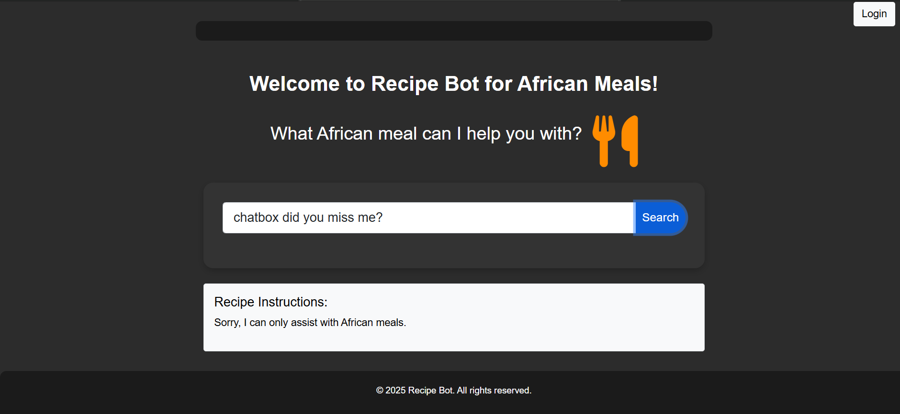
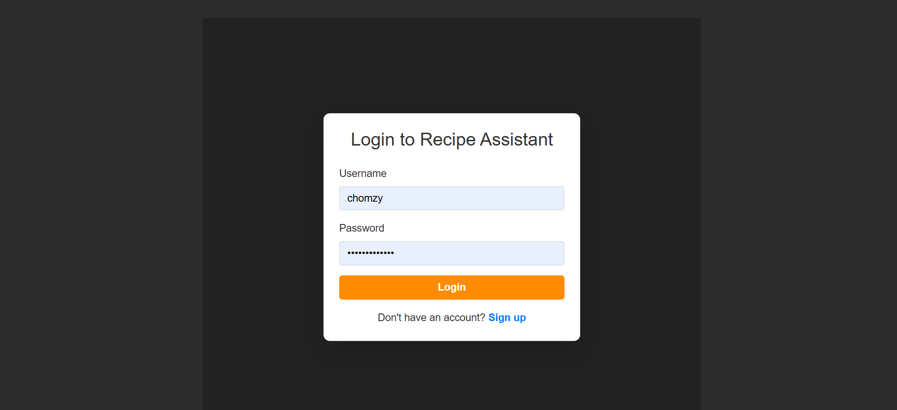

# 🍽️ Recipe Assistant Web Application

## 🚀 Overview
The Recipe Assistant Web Application is a full-stack Django-based platform designed to provide users with step-by-step cooking instructions for a variety of meals, with a focus on African cuisine. The application enables users to explore recipes, interact with intelligent assistance, and manage personalised cooking experiences.

This project demonstrates strong backend development, data handling, and user authentication systems, alongside responsive frontend design.

A full-stack Django application that delivers intelligent, step-by-step cooking guidance using structured data and AI integration.

---

## 🛠️ Tech Stack
- Python
- Django
- Django REST Framework
- Bootstrap (Frontend)
- SQLite / PostgreSQL (Database)
- OpenAI API (for intelligent interaction)

---

## ✨ Features
- 🔐 User authentication (login & registration)
- 🍲 Recipe browsing and step-by-step cooking instructions
- ⭐ Save favourite recipes
- 🤖 AI-powered cooking assistance (OpenAI integration)
- 📱 Fully responsive design (mobile, tablet, desktop)
- 🔎 Structured data management for efficient retrieval

---

## ⚙️ System Design Highlights
- Implemented MVC architecture using Django
- Designed reusable components for scalability
- Structured backend logic for efficient data storage and retrieval
- Integrated external APIs to enhance functionality

---

## 🧠 Key Learnings
- Building scalable backend systems using Django
- Implementing secure authentication and user management
- Handling structured data and database operations
- Integrating third-party APIs into applications
- Designing responsive user interfaces

---
## 📸 Screenshots

