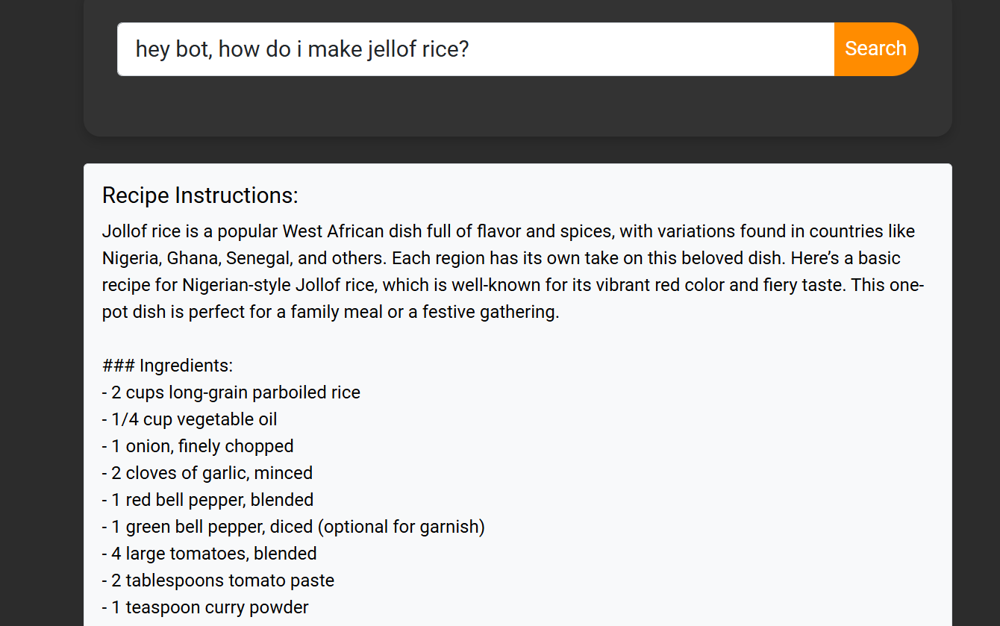
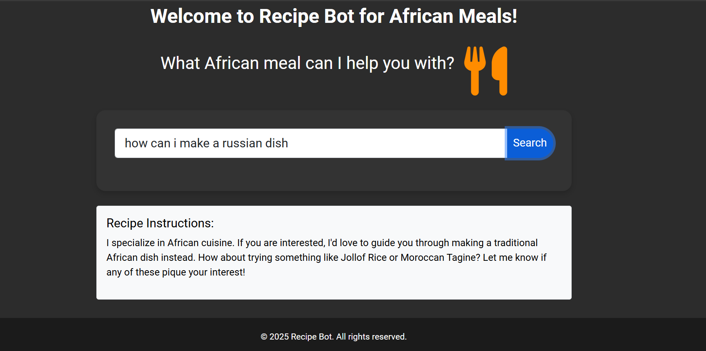
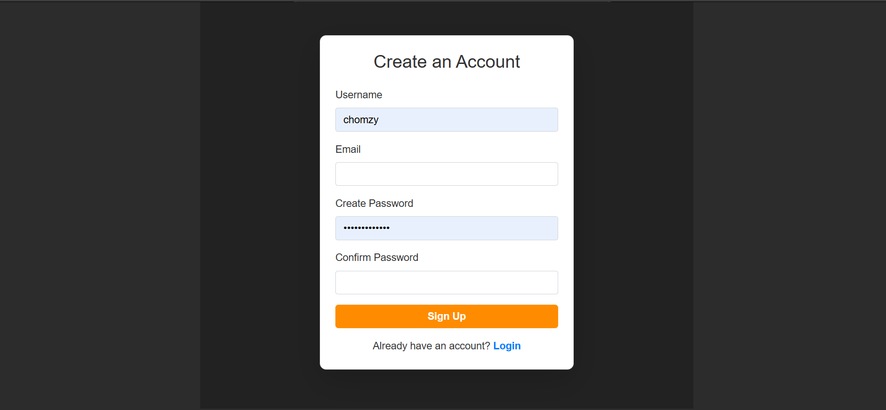

# 🍲 Recipe Bot — AI Recipe Assistant for African Meals

A Django web app that gives step-by-step cooking instructions for African dishes. Type in a meal like *jollof rice* or *egusi soup* and the assistant, powered by the OpenAI API, explains how to cook it. Questions about non-African food are politely redirected.


---

## ✨ Features

- **AI cooking assistant**: ask for any African dish and get ingredients and step-by-step instructions
- **Scoped to African cuisine**: a system prompt keeps answers focused on African meals and redirects other questions
- **User accounts**: sign up and log in with token-based authentication (Django REST Framework)
- **Email verification**: new users receive a verification link before they can log in
- **REST API**: separate endpoints for auth and the chatbot, so the backend can serve other clients
- **Responsive UI**: dark theme built with Bootstrap 5 and Font Awesome

---

## 🛠️ Tech Stack

| Layer | Tools |
|---|---|
| Backend | Python, Django, Django REST Framework |
| AI | OpenAI API (GPT-4 Turbo) |
| Auth | Custom user model, DRF token auth, email verification |
| Frontend | Django templates, Bootstrap 5, Font Awesome, vanilla JavaScript |
| Database | SQLite (development) |

---

## 📸 Screenshots

### Home: ask about an African meal


<!-- Add your new screenshots below. Save them in the images/ folder and uncomment the lines. -->

<!--
### Recipe response

-->

<!--
### Off-topic question redirected

-->

### Sign up and log in

| Sign up | Log in |
|---|---|
|  |  |

<!--
### Email verification

-->

<!--
### Mobile view

-->

---

## 📁 Project Structure

```
Recipe-assistant-for-african-meals/
├── recipe_assistant/   # Project config (URLs, WSGI/ASGI)
├── users/              # Custom user model, sign up, login, email verification, templates
├── chatbot/            # OpenAI-powered recipe chatbot API
├── recipe/             # Recipe model and image generation (in progress)
├── images/             # README screenshots
└── manage.py
```

---

## 🔌 API Endpoints

| Method | Endpoint | Description |
|---|---|---|
| `POST` | `/api/auth/register/` | Create an account and send a verification email |
| `GET` | `/api/auth/verify/<token>/` | Verify the user's email |
| `POST` | `/api/auth/login/` | Log in and receive an auth token |
| `POST` | `/api/chatbot/chat/` | Send `{"message": "How do I make jollof rice?"}` and get a recipe reply |

---

## 🚀 Getting Started

### Prerequisites
- Python 3.10+
- An [OpenAI API key](https://platform.openai.com/api-keys)
- An email account for sending verification emails (e.g. Gmail with an app password)

### Installation

```bash
# 1. Clone the repo
git clone https://github.com/<your-username>/Recipe-assistant-for-african-meals.git
cd Recipe-assistant-for-african-meals

# 2. Create and activate a virtual environment
python -m venv venv
source venv/bin/activate        # Windows: venv\Scripts\activate

# 3. Install dependencies
pip install django djangorestframework openai python-dotenv
```

### Environment variables

Create a `.env` file in the project root (it's already in `.gitignore`):

```env
SECRET_KEY=your-django-secret-key
OPENAI_API_KEY=your-openai-api-key
EMAIL_HOST_USER=your-email@gmail.com
EMAIL_HOST_PASSWORD=your-app-password
```

### Run the app

```bash
python manage.py makemigrations users
python manage.py migrate
python manage.py runserver
```

Open http://127.0.0.1:8000 in your browser.

---

## 🧠 What I Learned

- Structuring a Django project into focused apps (users, chatbot, recipes)
- Building a custom user model with email verification and token authentication
- Designing REST endpoints with Django REST Framework
- Integrating the OpenAI API and using a system prompt to keep the assistant on topic
- Connecting a JavaScript frontend to a Django API with `fetch`

---

## 🗺️ Roadmap

- [ ] AI-generated images of each dish (DALL·E 3)
- [ ] Save favourite recipes to a user profile
- [ ] Store verification tokens in the database instead of memory
- [ ] Deploy to a live host

---

## 👤 Author

**Uche**: [GitHub](https://github.com/<your-username>) · [LinkedIn](https://linkedin.com/in/<your-profile>)
